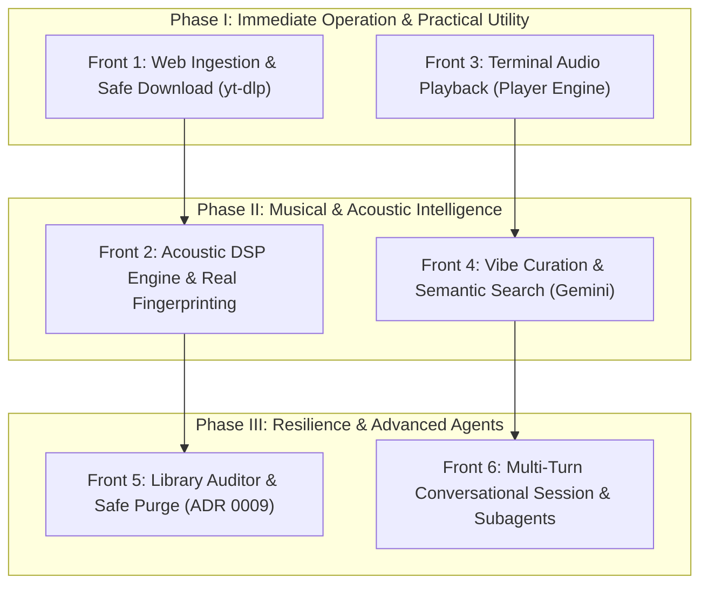

# Functional Roadmap: Next Real Features

> **Project**: MusicMatch
> **Formalized**: September 2026 (status last updated November 2026)
> **Status**: Approved for planning
> **Architectural reference**: Builds on ADRs 0001 to 0013 and the engineering studies in `docs/`

---

## 1. Overview and Evolution Context

**MusicMatch** consolidated its technical foundation in version `0.2.0`:
- **Clean Architecture & DDD**: Strict separation between Presentation (`ConsoleUI`), Commands (`CommandRegistry`), Application Services (`LibraryService`), Domain (`Track`, `ScanResult` in Pydantic V2) and Persistence (`SQLiteTrackRepository` with SQLite FTS5).
- **Idempotent Scanning & Stat-Cache ([ADR 0009](adr/0009-library-idempotency-stat-cache-and-lifecycle-policy.md))**: Canonical SHA-256 key (`trk_<hash>`), instant $O(1)$ validation by `mtime` and byte size, and a non-destructive lifecycle policy (`AVAILABLE` vs `MISSING`).
- **Automated Test Suite**: Unit and integration tests covering happy and failure paths, run by `scripts/check.py` locally and in CI.

With the data, persistence and harness foundations validated, this document defines the **6 feature fronts** that turn MusicMatch into a state-of-the-art, AI-native music manager and player.

---

## 2. Status at a Glance

| Front | Status | Tracking |
| :--- | :--- | :--- |
| **Front 1: Web Ingestion & Safe Download (`yt-dlp`)** | ✅ Delivered in 0.2.0 (`/download`, `/staging`, `/promote`) | PRs #1, #2 · leftovers (`/inspect-url`, `download_track` agent tool): issue #13 |
| **Front 2: Acoustic DSP Engine & Real Fingerprinting** | ⏳ Planned | Issue #11 |
| **Front 3: Terminal Audio Playback (Player Engine)** | ⏳ Planned, next by priority | Issue #9 |
| **Front 4: Vibe Curation & Semantic Search (Gemini)** | ⏳ Planned | Issue #10 |
| **Front 5: Library Auditor, Consolidation & Safe Deletion** | ✅ Delivered in 0.2.0 (`/audit`, `/delete`, `/prune`, `/retag`, `/unindex`, `/library import \| reorganize`) | ADR 0013 |
| **Front 6: Multi-Turn Conversational Session & Subagents** | ⏳ Planned | Issue #12 |

Issue and PR numbers refer to `icarosaggioro/musicmatch` on GitHub.

---

## 3. Strategic Map of the Feature Fronts

---

## 4. Technical Detail of the 6 Fronts

---

### Front 1: Web Ingestion and Safe Download with `yt-dlp`

**Status:** ✅ Delivered in 0.2.0. Not yet delivered: `/inspect-url` and the `download_track` agent tool (issue #13).

#### Goal
Let the user and the AI agent bring new music directly from web platforms (YouTube, SoundCloud, Bandcamp) into the local library, with instant cataloging in the database.

#### Technical Rationale
As described in the reports [`docs/YT-DLP_RELATORIO_TECNICO.md`](YT-DLP_RELATORIO_TECNICO.md) and [`docs/YT-DLP_RELATORIO_TECNICO_E_SEGURANCA.md`](YT-DLP_RELATORIO_TECNICO_E_SEGURANCA.md), [ADR 0010 - yt-dlp Integration Strategy](adr/0010-yt-dlp-integration-and-packaging-strategy.md), [ADR 0011 - Web Ingestion Pipeline, Two-Stage Staging Architecture, and Managed Library Taxonomy](adr/0011-web-ingestion-two-stage-staging-and-managed-library-taxonomy.md) and [ADR 0012 - Managed Library Governance and Resolution](adr/0012-managed-library-governance-resolution-and-safeguards.md), the web ingestion architecture follows a two-stage model with a canonical taxonomy:
1. **SSRF and Resource Hardening**: `enable_file_urls: False`, a `match_filter` that rejects endless live streams (`!is_live`), and a maximum duration limit (e.g. 30 minutes).
2. **Path Traversal Protection**: Strict use of `prepare_filename` or canonical IDs, so malicious web titles cannot become file paths.
3. **Audio Post-Processing**: Transparent conversion via `FFmpegExtractAudio` to MP3/FLAC in a dedicated directory (`data/downloads` or a folder configured in `.env`).
4. **Code Isolation and CI/CD**: `yt-dlp` code kept out of `src/`; local development links to a local `yt-dlp` clone via `pip install -e`, and GitHub Actions resolves it automatically.
5. **Native Audio Preservation**: Extracts the best stream without transcoding loss (`.m4a`/`.opus`), with optional on-demand conversion to 320 kbps MP3 (`--format mp3`).
6. **Staging Isolation & Canonical Taxonomy**: Ingestion partitioned into sessions with `session.json` manifests, non-destructive promotion, and a physical layout of `Artists/<Artist>/<Album>`, `Artists/<Artist>/Singles`, `Various Artists/<Album>` and `Collections/<Name>`.
7. **Cross-Platform Library Governance**: Canonical resolution to `~/Music/MusicMatch/` (Windows, macOS, Linux), an atomic write check (`.musicmatch_probe`), and rejection of operating-system critical paths.

#### Components to Create / Modify
* **`musicmatch.services.downloader` (`AudioDownloaderService`)**:
  - Wraps `YoutubeDL` calls, run off the REPL main thread via `asyncio.to_thread` / `run_in_executor`.
  - Emits download progress events (percentage, speed, ETA) to the interface.
* **Agent tool (`musicmatch.tools.downloader`)**:
  - `download_track(url: str, target_genre: Optional[str] = None) -> dict`: Inspects online metadata, confirms validity and ingests the track.
* **CLI commands**:
  - `/download <url>`: Starts the download in the terminal with a text progress bar.
  - `/inspect-url <url>`: Queries remote metadata without downloading the file (`skip_download=True`).
* **`LibraryService` integration**:
  - When download and tag conversion finish, triggers the `AudioScanner` on the downloaded file, inserting it immediately into `tracks` and `tracks_fts`.

---

### Front 2: Acoustic DSP Engine and Real Fingerprinting

**Status:** ⏳ Planned (issue #11).

#### Goal
Replace provisional audio metrics with real analysis of the audio signal, enabling acoustic deduplication and recommendations grounded in the physics of sound.

#### Technical Rationale
Today `bpm` depends on manual ID3 tags (or defaults to `120.0`) and `lufs` (loudness) stays `None`. Real acoustic analysis raises catalog quality:
1. **Acoustic Fingerprinting (Chromaprint / AcoustID)**:
   - Extracts the fingerprint vector from the decoded bitstream via `pyacoustid` / `fpcalc`.
   - Matches tracks whose file names or tags differ but whose recording is the same.
2. **Integrated Loudness Measurement (EBU R128 / LUFS)**:
   - Measures perceived loudness per the international EBU R128 standard (momentary, short-term and integrated windows).
   - The basis for gain normalization (*ReplayGain*) without digital clipping.
3. **Acoustic BPM and Beat Grid Detection**:
   - Energy-transient detection and rhythmic correlation to find the track's exact tempo.
4. **Harmonic Analysis and Musical Key (*Camelot Wheel*)**:
   - Identifies the tonic and mode (e.g. 8A / A minor, 11B / A major) to enable harmonic mixing and transitions.
5. **Mini-Waveform Cache**:
   - Generates condensed peak vectors (RMS/Peak) stored as binary or light JSON in the database for instant visual rendering.

#### Components to Create / Modify
* **`musicmatch.services.dsp` (`AudioDSPService`)**:
  - Pipeline computing LUFS, BPM and fingerprint.
  - Ready for later integration with the compiled Rust library (`musicmatch_core` via PyO3).
* **Database migration**:
  - New structured columns on the `tracks` table: `fingerprint TEXT`, `musical_key TEXT`, `waveform_peaks BLOB/TEXT`.

---

### Front 3: Integrated Terminal Audio Playback (Player Engine)

**Status:** ⏳ Planned, next by priority (issue #9).

#### Goal
Let the user play tracks directly from the MusicMatch interface, with transport controls, a play queue and a visual progress indicator.

#### Technical Rationale
The application manages local audio libraries but still depends on external players. A built-in player completes the user experience:
1. **Lightweight, Concurrent Audio Engine**:
   - Decodes and sends PCM to the operating system's audio driver without blocking the terminal command loop.
   - Backend options: `miniaudio`, `pygame.mixer` or `sounddevice`.
2. **Playback State Control**:
   - States: `STOPPED`, `PLAYING`, `PAUSED`.
   - Continuous tracking of the current position (`current_time_seconds`) against the total duration.

#### Components to Create / Modify
* **`musicmatch.services.player` (`AudioPlayerService`)**:
  - Singleton controlling playback, volume, play, pause, resume, seek and the play queue.
* **`ConsoleUI` presentation**:
  - Mini-player in the terminal footer or on demand: `[▶ Playing] Queen - Bohemian Rhapsody [02:14 / 05:55] [██████░░░░]`.
* **CLI commands**:
  - `/play <id | search term>`: Finds the track via FTS5 and starts playback immediately.
  - `/pause`: Pauses playback.
  - `/resume`: Resumes playback.
  - `/stop`: Stops playback and resets the position.
  - `/volume <0-100>`: Sets the output volume.
  - `/queue`: Shows and manages the upcoming tracks.
* **Agent tool**:
  - `play_track(query_or_id: str)`: Lets natural-language requests (e.g. *"Play a calm jazz track"*) start playback directly.

---

### Front 4: "Vibe" Curation & Semantic Search with Google Gemini

**Status:** ⏳ Planned (issue #10).

#### Goal
Turn MusicMatch into an intelligent music curator that understands acoustic nuance, times of day, feelings and listening contexts.

#### Technical Rationale
Use the multimodal Gemini model family (`gemini-3.6-flash` / `gemini-3.1-pro`) and its deep reasoning capabilities:
1. **Batch Semantic Classification and Enrichment**:
   - A background routine analyzes existing metadata and fills the `mood` field of tracks where it is empty (e.g. *"energetic, steady running rhythm, retro synthesizers"*).
2. **Natural-Language Vibe Search**:
   - The user asks: *"Upbeat 80s songs over 120 BPM for coding"* or *"Melancholic acoustic guitar tracks similar to Radiohead"*.
   - The agent analyzes the request, translates it into relational parameters plus FTS5 index terms, and selects the ideal sequence.
3. **Smart Playlist Generation with Harmonic Criteria**:
   - Combines DSP variables (close BPM and *Camelot Wheel* key compatibility) with mood compatibility, producing smooth playlist transitions.

#### Components to Create / Modify
* **`musicmatch.services.curator` (`CuratorService`)**:
  - Playlist synthesis, harmonic ordering, and batch enrichment with Gemini.
* **Agent tools**:
  - `create_smart_playlist(theme_or_vibe: str, target_duration_minutes: int) -> dict`.
* **CLI commands**:
  - `/vibe <vibe description>`: Shortcut for quick natural-language curation.
  - `/enrich-mood [limit]`: Starts mood enrichment for tracks not yet categorized.

---

### Front 5: Library Auditor, Consolidation & Safe Deletion (ADR 0009 & ADR 0013)

**Status:** ✅ Delivered in 0.2.0.

#### Goal
Implement full governance of physical and logical library maintenance: consolidating external directories, unindexing from the database, safe physical deletion through the OS Recycle Bin, analytic auditing and direct tag editing.

#### Technical Rationale
As specified in [ADR 0009](adr/0009-library-idempotency-stat-cache-and-lifecycle-policy.md) and [ADR 0013](adr/0013-library-maintenance-consolidation-and-deletion-safeguards.md):
1. **Strict Separation between Unindexing and Deleting**:
   - `/unindex`: Removes only the metadata and FTS5 index entries from SQLite, keeping the file on disk.
   - `/delete`: Moves the physical file to the operating system's Recycle Bin (`send2trash`) and purges the database records.
2. **Two-Level Safeguards**:
   - **Single track**: Interactive confirmation showing metadata, with a highlighted `External Storage Warning` when the track lives outside the `Managed Library Directory`.
   - **Batches / sets**: Require the *Count-Verification Gate*, making the user type the exact number of affected files before anything is discarded.
3. **Physical Consolidation via `/library import`**:
   - Imports external folders into the standard taxonomy (`Artists/<Artist>/<Album>/`) via `--copy` or `--move`.
   - In `--move` mode, applies *Per-Item Pre-Flight Isolation*, testing read and delete permission at the source file by file (locked files stay untouched in the source folder).
4. **Diagnostic Dashboard and Deduplication (`/audit`)**:
   - Dashboard with total `AVAILABLE` vs `MISSING` tracks, duplicates, untagged tracks and low bitrates (< 128 kbps).
   - `/audit duplicates`: Guided resolution with a heuristic that recommends keeping the highest-fidelity recording.
5. **Physical Tag Editing and Reorganization**:
   - `/retag`: Writes metadata directly to the file via `mediafile` and updates the database instantly.
   - `/library reorganize`: Realigns the `Managed Library` folder structure to reflect corrected tags.

#### Components to Create / Modify
* **`musicmatch.commands.unindex` (`UnindexCommand`)**:
  - `/unindex <id | query | --missing>`: Surgical unindexing in the database.
* **`musicmatch.commands.delete` (`DeleteCommand`)**:
  - `/delete <id | query | --missing>`: Deletion through `send2trash`, with an external-folder warning and the *Count-Verification Gate*.
* **`musicmatch.commands.audit` (`AuditCommand`)**:
  - `/audit`: General dashboard.
  - `/audit duplicates`: Smart duplicate comparison and resolution.
  - `/audit prune`: Purges `MISSING` tracks.
* **`musicmatch.commands.retag` (`RetagCommand`)**:
  - `/retag <id> [--artist] [--title] [--album] [--genre]`.
* **`LibraryCommand` subcommands**:
  - `/library import <path> [--copy | --move]` and `/library reorganize`.
* **Domain services**:
  - `LibraryMaintenanceService`: Encapsulates safe import, pre-flight checks, unindex and delete with `send2trash`.

---

### Front 6: Multi-Turn Conversational Session in the REPL

**Status:** ⏳ Planned (issue #12).

#### Goal
Evolve the single-turn agent ([ADR 0003](adr/0003-didactic-incremental-evolution.md)) into a continuous conversational assistant with context history and support for orchestrating subagents.

#### Technical Rationale
1. **Dynamic Conversation History**:
   - Keeps context across the interactive session through the chat API (`client.chats.create` in the `google-genai` SDK).
   - Enables chained dialogs such as:
     - *User*: "Find classic rock tracks."
     - *Agent*: "I found 5 tracks: Queen, Led Zeppelin..."
     - *User*: "Play the second one." (the agent infers Led Zeppelin).
2. **Specialized Subagents**:
   - Prepare the ecosystem for autonomous subagents following the Google Antigravity SDK pattern:
     - `LibrarianAgent`: Folder organization, downloads and reconciliation.
     - `CuratorAgent`: Specialist in harmony, mood and assembling music sets.
     - `AuditorAgent`: Integrity diagnostics and background repairs.

#### Components to Create / Modify
* **`musicmatch.agent.session` (`MultiTurnAgentSession`)**:
  - Manages turn history, short-term memory and the integrated ReAct cycle.
* **`Harness` adaptation**:
  - Routes the continuous conversational flow to the active agent session.

---

## 5. Prioritization Matrix and Recommended Schedule

| Order | Feature Front | User Impact | Complexity | Main Dependencies | Status |
| :---: | :--- | :---: | :---: | :--- | :--- |
| **1** | **Front 1: Web Ingestion (`yt-dlp`)** | 🟢 High | 🟡 Medium | `yt-dlp`, `ffmpeg` | ✅ Delivered |
| **2** | **Front 3: Audio Playback (Player)** | 🟢 High | 🟡 Medium | `miniaudio` / sound backend | ⏳ Next |
| **3** | **Front 5: Auditor & Purge (ADR 0009)** | 🟡 Medium | 🟢 Low | SQLite / existing schema | ✅ Delivered |
| **4** | **Front 4: Vibe Curation & AI** | 🟢 High | 🟡 Medium | `google-genai` / Gemini API | ⏳ Planned |
| **5** | **Front 2: DSP Engine & Fingerprint** | 🟢 High | 🔴 High | `pyacoustid`, audio libraries | ⏳ Planned |
| **6** | **Front 6: Multi-Turn Session & Subagents** | 🟡 Medium | 🟡 Medium | `google-genai` chats / SDK | ⏳ Planned |

---

## 6. Quality Guidelines for Execution

1. **Test-Driven Development (TDD)**: Every new tool, command or service ships with unit tests using proper mocks (no real network calls and no dependency on sound devices in CI tests).
2. **Security Isolation**: Strictly follow the SSRF, DoS and parameter-injection hardening rules documented for `yt-dlp`.
3. **Cross-Platform Compatibility**: File paths and audio decoders must work correctly on native Windows/NTFS.
4. **Language Conventions**: Follow `.agents/rules/instructions.md`: everything stored in the repository (code, commits, docs) is in English; conversation with the user follows the user's language.
