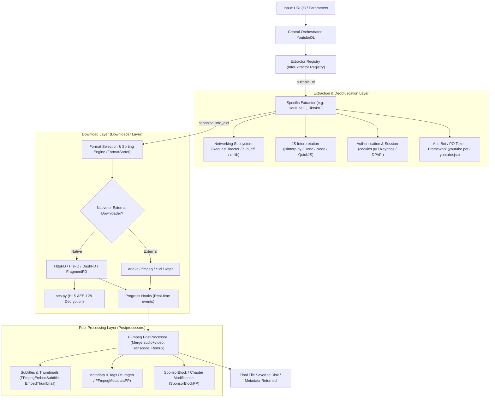

# Software Engineering Technical Report: In-Depth Analysis of the `yt-dlp` Codebase

---

## 1. Overview and Purpose of the Project

**`yt-dlp`** is the most advanced and widely used Python tool and library in the world for extracting metadata, streaming and downloading audio and video from the web. It started as an active fork of the legendary `youtube-dl`, aiming to solve critical problems that hit the original project: download speeds slowed by YouTube throttling, a temporary halt in maintenance, vulnerability to anti-bot protections, and no support for modern streaming protocols.

Today `yt-dlp` has grown into an independent engineering ecosystem with more than **1,700 specialized extractors** covering not only YouTube but hundreds of platforms, such as:
- **Social Networks & Short Video**: TikTok, Instagram, Twitter/X, Bluesky, Facebook, Reddit.
- **Live Streaming & Gaming**: Twitch, Kick, Bilibili, Niconico, Huya, Douyu.
- **Music & Podcast Platforms**: SoundCloud, Bandcamp, Apple Podcasts, Spotify (metadata), Mixcloud, Jamendo.
- **Media Portals and VOD**: Vimeo, Dailymotion, Rumble, educational platforms (Udemy, Teachable, Coursera, MIT), government and news portals.

The code runs in two fundamental modes:
1. **Command-Line Tool (CLI)**: A standalone executable or package run from the terminal with hundreds of configuration parameters.
2. **Python Library / SDK (Core Engine)**: Plain classes that can be instantiated and integrated directly into backends (FastAPI, Django, Celery, automation scripts or Artificial Intelligence pipelines).

---

## 2. System Architecture and Execution Flow

The `yt-dlp` architecture is a highly decoupled, modular and extensible layered pipeline:



### 2.1. The Lifecycle of an Operation (`YoutubeDL.py`)
All orchestration lives in the [`YoutubeDL`](https://github.com/yt-dlp/yt-dlp/blob/master/yt_dlp/YoutubeDL.py) class:
1. **Initialization**: The class receives a `params` dictionary (`ydl_opts`). It loads cookies if configured, initializes the network director (`RequestDirector`), builds the handler chain and registers the extractors (lazily via `lazy_extractors.py` for instant startup).
2. **URL Resolution (`extract_info`)**: Iterates over the registered extractors. The `ie.suitable(url)` method evaluates the `_VALID_URL` matching regex.
3. **Metadata Extraction (`ie.extract(url)`)**: The extractor performs API calls or HTTP scraping. It returns a canonical dictionary called `info_dict`.
4. **Recursive Resolution (`process_ie_result`)**: If the result is a playlist (`_type == 'playlist'`), its items are evaluated lazily (`LazyList`), allowing infinite streaming or continuous pagination without excessive memory use.
5. **Media Ranking and Selection (`process_video_result`)**: The format selector analyzes every available stream (DASH, HLS, direct MP4) and picks the ideal video + audio combination according to the format string (e.g. `bestvideo+bestaudio/best`).
6. **Download (`process_info`)**: Dispatches the stream to the matching `FileDownloader` (`HttpFD`, `HlsFD`, `DashFD`, or external executables such as `aria2c`).
7. **Post-Processing (`postprocess`)**: Runs the `PostProcessor` chain, calling `ffmpeg` to merge tracks, embed subtitles, adjust covers and write ID3/MP4 metadata via `mutagen`.

---

## 3. Main Internal Modules and Subcomponents

### 3.1. Modern Networking Subsystem (`yt_dlp.networking`)
Unlike the old `youtube-dl`, which relied only on the standard library's `urllib`, `yt-dlp` has a state-of-the-art networking subsystem:
- **`RequestDirector` & `RequestHandler`**: Dynamic, capability-based routing of HTTP requests.
- **`curl_cffi` Support and TLS Impersonation**: Can force TLS fingerprints (JA3/JA4, HTTP/2 frames, cipher suites) that mimic real browsers (Chrome, Safari, Firefox, Edge). This gets past aggressive WAF defenses from Cloudflare, Akamai and Datadome without browser automation via Selenium/Playwright.
- **WebSocket Transport**: Native support for WebSocket protocols (e.g. Niconico live downloads and YouTube chat).

### 3.2. Cookie Extraction and Decryption (`yt_dlp.cookies`)
Can extract authenticated cookies directly from the browser profiles installed on the user's machine, without requiring a manual login:
- Supports: **Chrome, Edge, Brave, Opera, Vivaldi, Firefox, Safari**.
- Implements native decryption of passwords and master keys:
  - **Windows**: DPAPI (`CryptUnprotectData`) + AES-256-GCM (Chromium's `v10`/`v20` scheme).
  - **macOS**: Keychain via the `security` command.
  - **Linux**: Secret Service API / D-Bus / GNOME Keyring / KWallet via `secretstorage` or `jeepney`.

### 3.3. Pure AST JavaScript Interpreter (`yt_dlp.jsinterp`)
Platforms such as YouTube dynamically change their download parameters (e.g. deobfuscating `s` signatures and computing the `n` throttling parameter).
- Instead of requiring Node.js, `yt-dlp` includes a **complete JavaScript interpreter written in pure Python** (`jsinterp.py`).
- It tokenizes and interprets JS expressions, function calls, array prototype manipulation (`slice`, `splice`, `reverse`) and 32-bit bitwise arithmetic, decrypting the algorithm directly in memory.
- Besides the native interpreter, it supports external engines such as Deno, Bun, Node and QuickJS via [`_jsruntime.py`](https://github.com/yt-dlp/yt-dlp/blob/master/yt_dlp/utils/_jsruntime.py).

### 3.4. Resilient Cryptography (`yt_dlp.aes`)
HLS (`m3u8`) streams often come split into `.ts` or `.m4s` chunks encrypted with **AES-128-CBC**.
- The [`aes.py`](https://github.com/yt-dlp/yt-dlp/blob/master/yt_dlp/aes.py) module provides high-performance decryption if `pycryptodomex` is installed.
- If no external C library is present, it runs a **native pure-Python AES implementation** (with key expansion and S-Box tables implemented mathematically), so the program never breaks for lack of compiled dependencies.

### 3.5. Anti-Bot and PO Token Framework (`yt_dlp.extractor.youtube.pot` & `jsc`)
In 2024–2026, YouTube introduced the **PO Token (Proof-of-Origin Token)**, adding Botguard / Attestation (WebPO) challenges to verify that requests come from authorized clients.
- `yt-dlp` designed a pluggable provider architecture:
  - **PO Token Providers (`pot`)**: Providers that resolve attestation tokens for Innertube clients (`WEB`, `ANDROID`, `TVHTML5`).
  - **JS Challenge Providers (`jsc`)**: Providers that solve complex mathematical challenges from new players.

### 3.6. Declarative Traversal Utility (`yt_dlp.utils.traversal.traverse_obj`)
One of the functional gems of the codebase:
- Queries and transforms complex JSON/dict/list trees from APIs with a concise syntax, handling missing keys, index errors, type transformations, predicate filters and alternative (fallback) paths in a single line.

---

## 4. Dependency Matrix

One of `yt-dlp`'s most impressive engineering decisions is its philosophy: **zero mandatory external dependencies**.

| Component | Type | Role in the System | Impact if Missing |
| :--- | :--- | :--- | :--- |
| **Python 3.10+** | **Required** | Base runtime of the project | Does not run on versions below 3.10. |
| **FFmpeg & FFprobe** | **External Binary (Highly Recommended)** | Merging DASH video/audio, audio extraction, remuxing, subtitle conversion | Cannot download 1080p/4K/8K qualities when the server serves video and audio separately. |
| **curl-cffi** | **Python (Optional)** | TLS impersonation of real browsers (avoids WAF blocks) | Falls back to `urllib`/`requests`; some Cloudflare-protected sites will return HTTP 403. |
| **pycryptodomex** | **Python (Optional)** | C acceleration of AES decryption (HLS and cookies) | `yt-dlp` uses the native pure-Python `aes.py` (more CPU-intensive for heavy videos). |
| **mutagen** | **Python (Optional)** | Writing tags and covers into audio files (MP3, FLAC, M4A) | Rich ID3/MP4 metadata is not embedded in the final audio. |
| **websockets** | **Python (Optional)** | Bidirectional WebSocket communication | Downloads of live streams over WebSocket will fail. |
| **brotli / brotlicffi** | **Python (Optional)** | Decompressing Brotli (`br`) HTTP responses | Web servers that only accept Brotli may fail. |
| **certifi** | **Python (Optional)** | Up-to-date CA certificate chain | Relies on the operating system's certificates. |
| **secretstorage / jeepney** | **Python (Optional)** | Keyring access on Linux (GNOME Keyring / KWallet) | Cannot decrypt browser cookies on Linux. |
| **Deno / Node / Bun** | **External Binary (Optional)** | Running complex/heavy JS challenges | Uses the internal `jsinterp.py` (enough in most cases). |
| **aria2c** | **External Binary (Optional)** | Multi-threaded downloader with simultaneous connections | Uses the native downloaders with a single connection per fragment. |

---

## 5. Reuse Possibilities in Other Projects

If you already have other projects (web systems, automation bots, data processing or Artificial Intelligence pipelines), `yt-dlp` can be used in several ways:

### Scenario A: Real-Time Metadata Extraction (Without Downloading the Video)
Ideal for catalog enrichment, link checking, view counts, and fetching transcripts and subtitles:
```python
from yt_dlp import YoutubeDL

ydl_opts = {
    'quiet': True,
    'skip_download': True,
    'extract_flat': False,
}

with YoutubeDL(ydl_opts) as ydl:
    info = ydl.extract_info("https://www.youtube.com/watch?v=dQw4w9WgXcQ", download=False)
    
    video_data = {
        'id': info.get('id'),
        'title': info.get('title'),
        'duration': info.get('duration'),
        'uploader': info.get('uploader'),
        'view_count': info.get('view_count'),
        'thumbnail': info.get('thumbnail'),
        'subtitles': list(info.get('subtitles', {}).keys()),
        'formats_count': len(info.get('formats', []))
    }
```

### Scenario B: Audio Ingestion Pipeline for AI Models (Whisper / Transcription)
Download audio converted directly to MP3/WAV for immediate processing:
```python
ydl_opts = {
    'format': 'bestaudio/best',
    'outtmpl': '/temp/path/%(id)s.%(ext)s',
    'postprocessors': [{
        'key': 'FFmpegExtractAudio',
        'preferredcodec': 'wav',
        'preferredquality': '192',
    }],
    'quiet': True,
}

with YoutubeDL(ydl_opts) as ydl:
    info = ydl.extract_info(url, download=True)
    audio_path = f"/temp/path/{info['id']}.wav"
    # Pass audio_path directly to Whisper / a transcriber
```

### Scenario C: Progress Tracking via Hooks for WebSockets / SSE
To show real-time progress bars in a front end (React, Vue or Flutter):
```python
def progress_callback(d):
    if d['status'] == 'downloading':
        percent = d.get('_percent_str', '0%')
        speed = d.get('_speed_str', 'N/A')
        eta = d.get('_eta_str', 'N/A')
        # Send the event to the web client over WebSocket:
        # websocket_manager.broadcast({"percent": percent, "speed": speed, "eta": eta})
    elif d['status'] == 'finished':
        filename = d['filename']
        # Notify completion

ydl_opts = {
    'progress_hooks': [progress_callback],
    'outtmpl': 'downloads/%(title)s.%(ext)s',
}
```

### Scenario D: Isolated Reuse of Specific Modules
You do not need to import the whole `YoutubeDL` if you only need utilities:
1. **`yt_dlp.cookies.extract_cookies_from_browser`**: Read cookies from local browsers to authenticate automation scripts or scrapers on other sites.
2. **`yt_dlp.utils.traversal.traverse_obj`**: Use as a deep search and filtering engine over complex JSON and REST API responses from any system.
3. **`yt_dlp.aes`**: Pure-Python AES CBC/GCM decryptor with no C libraries needed.
4. **`yt_dlp.networking.impersonate`**: A request layer with TLS fingerprinting.

---

## 6. Caveats, Challenges and Engineering Best Practices

When bringing `yt-dlp` into corporate or production environments:

1. **Thread Blocking (I/O Bound)**:
   - `extract_info()` and the downloaders are synchronous and blocking.
   - In **FastAPI, Tornado or asyncio** applications, never call them directly on the event thread. Use:
     ```python
     import asyncio
     loop = asyncio.get_running_loop()
     info = await loop.run_in_executor(None, lambda: ydl.extract_info(url, download=False))
     ```
   - In microservice architectures, downloading should be an asynchronous task decoupled through queues (**Celery**, **RQ**, **RabbitMQ** or **Redis**).

2. **Scraping Fragility and Natural Degradation (Bitrot)**:
   - Video platforms change their CSS selectors, internal APIs and anti-bot locks almost weekly.
   - A continuous dependency update pipeline (`pip install -U yt-dlp`) and automated smoke tests to confirm extraction still works are mandatory.

3. **Datacenter IP Blocking**:
   - Providers such as AWS, GCP, Azure, DigitalOcean and Hetzner face severe blocks or bot challenges from YouTube and Cloudflare.
   - For server environments, residential proxies or authentication via an exported cookie file (`--cookies` / `'cookiefile'`) are essential.

4. **Legal Aspects and Licensing**:
   - The original `yt-dlp` source code is under **The Unlicense** (public domain, free for commercial use, modification and redistribution without royalties).
   - Embedded or third-party components have specific licenses documented in `THIRD_PARTY_LICENSES.txt`.
   - Mind the copyright of downloaded content and the Terms of Service (ToS) of the platforms accessed.
